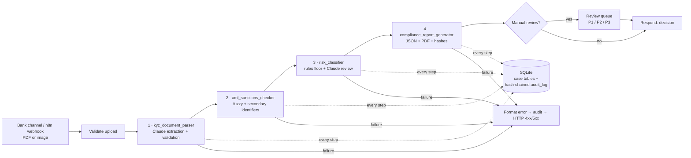
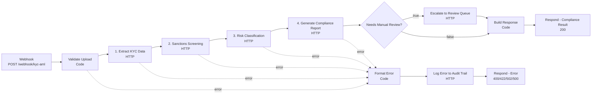

# KYC / AML Automation Workflow

**AI-assisted customer onboarding for Saudi banks: document extraction, sanctions screening, risk classification and audit-ready reporting, orchestrated with n8n.**

> Portfolio proof-of-concept. All people, companies, ID numbers and sanctions entries are **fictitious**. The sanctions list is a mock; this code is not intended for real compliance decisions.

---

## Contents

1. [The problem](#1-the-problem)
2. [What the system does](#2-what-the-system-does)
3. [Quick start](#3-quick-start)
4. [Architecture](#4-architecture)
5. [Project structure](#5-project-structure)
6. [Module reference](#6-module-reference)
7. [REST API](#7-rest-api)
8. [n8n workflow](#8-n8n-workflow)
9. [Database and audit trail](#9-database-and-audit-trail)
10. [Risk model](#10-risk-model)
11. [Sanctions screening method](#11-sanctions-screening-method)
12. [Testing](#12-testing)
13. [Compliance notes (SAMA, OFAC, UN)](#13-compliance-notes)
14. [Integrating with a real bank](#14-integrating-with-a-real-bank-theory)
15. [Limitations](#15-limitations)

---

## 1. The problem

In a typical Saudi bank onboarding flow, a KYC analyst:

1. Reads the customer's onboarding form and ID by hand and re-types the data into the core system.
2. Screens the name against OFAC, UN and domestic lists. Arabic names transliterate many ways (*Mohammed / Muhammad / Mohamed*, *Al-Rashidi / Alrashidi*), so exact-match tools miss real hits and fuzzy tools raise a lot of false positives.
3. Scores the customer's risk with a spreadsheet or checklist.
4. Writes up the decision and files evidence for the audit trail.

That takes hours per complex case. Most of the time goes to data entry and to clearing false positives, which leaves less time for actual judgement.

## 2. What the system does

| Stage | Automated by | Output |
|---|---|---|
| 1. Extract | Claude (PDF/image understanding, forced JSON schema), then deterministic validation | Structured customer record plus data-quality issues |
| 2. Screen | Transliteration-aware fuzzy matching, adjusted by DOB and nationality | `MATCH` / `POTENTIAL_MATCH` / `NO_MATCH`, with explainable scores |
| 3. Classify | Weighted rule engine with hard stops, plus Claude review (can escalate, can't downgrade) | `Low` / `Medium` / `High`, reasoning, SDD/CDD/EDD |
| 4. Report | JSON + PDF generator | One decision, full evidence, SHA-256 integrity hashes |
| 5. Persist | SQLite, append-only hash-chained audit log | Tamper-evident record of every step |
| Orchestrate | n8n webhook workflow with error branches | API response, review-queue escalation |

**Results on the bundled scenarios** (verified end to end through a live n8n instance):

| Doc | Scenario | Sanctions | Risk | Decision |
|---|---|---|---|---|
| 01 | Salaried Saudi engineer | NO_MATCH | Low (0) | Auto-approve (straight-through) |
| 02 | Name spelled *Muhammad Abdallah Alrashidi*; listed as *Mohammed Abdullah Al-Rashidi* | **MATCH** | High (100) | **Blocked, escalated to MLRO (P1)** |
| 03 | PEP family member running a money exchange; volume 30× income | NO_MATCH | High (100) | Refer to analyst (P2), EDD |
| 04 | Same name as a listed person, but DOB and nationality differ | NO_MATCH (false positive auto-cleared) | Medium (30) | Approve with standard CDD |
| 05 | Expired Iqama, occupation missing, source of funds "Cash" | NO_MATCH | Medium (30) | Refer to analyst (P3) |
| 06 | Scanned ID card (PNG, no text layer) | Claude vision only | | Clean 422 error in offline mode |

## 3. Quick start

```bash
pip install -r requirements.txt

# Optional: real Claude extraction + AI risk review. Without a key the system
# runs in OFFLINE mode (text-PDF parser + rules), which is fully deterministic.
export ANTHROPIC_API_KEY=sk-ant-...

python scripts/generate_sample_data.py   # (re)build sample documents from test_cases.json
python main.py --all                     # end-to-end demo on every sample
pytest -v                                # 38 tests (1 skipped without an API key)
python api_server.py                     # REST API on :8000 for n8n
```

Each run writes `reports/<case_id>.json` and `reports/<case_id>.pdf`, and records everything in `data/kyc_aml.db`. Example output for each decision type is in [`docs/sample_reports/`](docs/sample_reports/).

## 4. Architecture



### Data flow at each step

| Step | Input | Output (stored in) | Audit event |
|---|---|---|---|
| Upload | multipart `document` | file in `data/uploads/`, SHA-256 (`kyc_cases`) | `CASE_CREATED` |
| Extract | file | `{data, metadata}` (`customer_records`) | `STATUS_EXTRACTED` (+ output hash) |
| Screen | name, nationality, DOB | screening result (`screening_results`) | `STATUS_SCREENED` |
| Classify | extraction + screening | risk assessment (`risk_assessments`) | `STATUS_CLASSIFIED` |
| Escalate | case_id, priority, reason | `review_queue` row | `ESCALATED_FOR_REVIEW` |
| Report | case bundle | JSON + PDF (`compliance_reports`) | `STATUS_COMPLETED` |
| Any failure | exception | case status `FAILED` | `STATUS_FAILED` / `WORKFLOW_ERROR` |

### Design principles

- **The AI proposes and the rules set the floor.** Claude's risk level can raise a decision but never lower a rule-based one. Any AI escalation goes to a human.
- **Fail closed.** If extraction fails, the case is marked FAILED and never auto-approved. If Claude is unavailable during classification, the system falls back to rules only and flags the case for review.
- **Explainability.** Every score adjustment, risk factor and hard stop is recorded in plain language.
- **Structured AI output.** Every Claude call uses a forced tool call with a JSON schema, so free text is never parsed.
- **Data minimisation.** The ID number, phone and email are not sent to Claude for risk review, and the ID is masked in reports.
- **One code path.** The CLI (`main.py`), the one-shot API (`/process`) and the stage-by-stage API (used by n8n) all call the same functions.

## 5. Project structure

```
kyc-aml-automation/
├── main.py                          End-to-end demo / CLI (process_document())
├── api_server.py                    Flask REST API that n8n calls
├── kyc_document_parser.py           Stage 1: extraction + validation
├── aml_sanctions_checker.py         Stage 2: sanctions screening
├── risk_classifier.py               Stage 3: risk scoring
├── compliance_report_generator.py   Stage 4: JSON + PDF report
├── database_handler.py              SQLite persistence + audit chain
├── claude_client.py                 Shared Claude API wrapper (structured output, retries)
├── config.py                        All thresholds, weights, lists, paths, env overrides
├── kyc_aml_workflow.json            n8n workflow (import into n8n)
├── sanctions_list_mock.json         18 fictitious OFAC/UN-style entries
├── test_cases.json                  6 document scenarios + 10 screening scenarios
├── sample_kyc_documents/            5 KYC form PDFs + 1 scanned ID PNG
├── scripts/generate_sample_data.py  Builds sample docs from test_cases.json
├── tests/                           pytest suite (conftest.py, test_pipeline.py)
├── docs/sample_reports/             Example PDF reports, one per decision type
├── requirements.txt · .env.example · .gitignore
├── reports/                         Generated reports (git-ignored)
└── data/                            SQLite DB + uploads (git-ignored)
```

## 6. Module reference

### `kyc_document_parser.py`: Stage 1, extraction

**What it does:** turns a KYC document into a validated, normalised customer record.

- **Input:** path to a PDF/PNG/JPG/WEBP (max 20 MB).
- **Output:**
  ```json
  {
    "data": {"full_name": "Sara Abdulaziz Al-Mansour", "id_type": "NATIONAL_ID", "id_number": "1087654321",
             "nationality": "SA", "date_of_birth": "1992-04-18", "id_expiry_date": "2032-01-09",
             "occupation": "Process Engineer", "monthly_income_sar": 22000.0,
             "expected_monthly_volume_sar": 25000.0, "source_of_funds": "Salary", "pep_status": false, "...": "..."},
    "metadata": {"method": "claude|offline_text", "model": "...", "confidence": 1.0,
                 "missing_fields": [], "validation_issues": [], "document_sha256": "...", "extraction_notes": null}
  }
  ```
- **Key functions:**
  - `parse_document(path, use_claude=None)` is the entry point.
  - `_extract_with_claude()` sends the file natively (PDF `document` block or `image` block) and forces the `record_kyc_data` tool against `EXTRACTION_SCHEMA`.
  - `_extract_offline()` is the pdfplumber "Label: value" parser for text PDFs (demo/test fallback).
  - `normalise_and_validate()` runs for **both** engines. It converts countries to ISO-2 and dates (DD/MM/YYYY, Hijri via Claude) to ISO, turns money strings into numbers, checks Saudi ID format (National ID starts with 1, Iqama with 2, 10 digits), and flags document expiry and age < 18.
- **In the workflow:** called by `POST /api/v1/parse` (n8n node "1. Extract KYC Data").

### `aml_sanctions_checker.py`: Stage 2, screening

**What it does:** screens a name against the consolidated list and explains the result.

- **Input:** `screen_customer(name, nationality=None, date_of_birth=None, aliases=None, entity_type="individual")`
- **Output:** `status`, `top_score`, up to 5 `matches` (each with `name_score`, `final_score`, `adjustments`, `programs`, `decision`), `requires_review`, a plain-English `explanation`, the list version and the thresholds used.
- **Key functions:** `normalise_name()` (particles, transliteration, compound "Abd al-" names), `name_similarity()` (order-independent token-set/token-sort), `_apply_secondary_identifiers()` (DOB and nationality adjustments), `load_sanctions_list()` (cached).
- **In the workflow:** `POST /api/v1/screen` (node "2. Sanctions Screening").

### `risk_classifier.py`: Stage 3, risk

**What it does:** assigns Low / Medium / High with reasons, the due-diligence tier and next review date.

- **Input:** `classify_risk(extraction, screening, use_claude=None)`
- **Output:** `risk_level`, `risk_score` (0–100), `rule_based_level`, `ai_level`, `factors[]`, `hard_stops[]`, `reasoning`, `recommended_actions[]`, `due_diligence` (SDD/CDD/EDD), `requires_manual_review`, `review_reasons[]`, `next_review_date`, `method` (`rules` or `rules+claude`).
- **Key functions:** `_rule_engine()` (scoring and hard stops), `_claude_assessment()` (forced `record_risk_assessment` tool), `_rule_reasoning()` / `_default_actions()` (offline narrative).
- **In the workflow:** `POST /api/v1/classify` (node "3. Risk Classification").

### `compliance_report_generator.py`: Stage 4, report

**What it does:** produces the artefact an analyst, MLRO or examiner reads.

- **Input:** case bundle from `DatabaseHandler.get_case_bundle()` and the audit-chain status.
- **Output:** `reports/<case_id>.json` (system of record) and `reports/<case_id>.pdf`, with a decision banner, customer, extraction, screening table, risk factors, actions, audit trail and integrity hashes.
- **Key functions:** `decide()` (maps results to `BLOCK` / `REFER` / `APPROVE_CDD` / `AUTO_APPROVE`), `build_report()` (computes `report_sha256` over the report body), `render_pdf()` (reportlab), `generate_report()`.
- **In the workflow:** `POST /api/v1/report` (node "4. Generate Compliance Report").

### `database_handler.py`: persistence and audit

**What it does:** the data-access layer for all stage outputs plus the tamper-evident audit log.

- **Key methods:** `create_case`, `save_extraction`, `save_screening`, `save_risk_assessment`, `save_report`, `enqueue_review`, `log_audit`, `get_audit_trail`, `verify_audit_chain`, `get_case_bundle`, `list_cases`, `open_reviews`.
- **CLI:** `python database_handler.py list | verify | reviews | case --case-id KYC-...`

### `claude_client.py`: Claude wrapper

`call_structured(system, content, tool_name, tool_description, input_schema)` makes one Messages API call with `tool_choice` forced, SDK-level retries on 429/5xx, a timeout, and token/latency logging. `file_to_content_block()` base64-encodes PDFs and images.

### `main.py`: end-to-end demo

`process_document(path, db)` runs all stages, escalates if needed and returns a summary.

```bash
python main.py                         # default clean sample
python main.py path/to/doc.pdf         # one document
python main.py --all [--offline] [--json]
```

### `api_server.py`: REST API

See [section 7](#7-rest-api).

### `config.py`

Holds the thresholds (`SANCTIONS_MATCH_THRESHOLD=0.90`, `SANCTIONS_POTENTIAL_MATCH_THRESHOLD=0.80`), risk bands (High ≥ 60, Medium ≥ 30), FATF lists (as of the June 2026 plenary), occupation risk weights, the model name and `AI_MODE` (`auto` / `claude` / `offline`). Every value can be overridden with environment variables (`.env.example`).

## 7. REST API

Start it with `python api_server.py` (port `KYC_API_PORT`, default 8000). If `KYC_API_KEY` is set, every `/api/*` call needs the `X-API-Key` header.

| Method | Path | Body | Returns |
|---|---|---|---|
| GET | `/health` | | status, AI mode, model |
| POST | `/api/v1/parse` | multipart `document` | `case_id`, `extraction` |
| POST | `/api/v1/screen` | `{case_id}` | `screening` |
| POST | `/api/v1/classify` | `{case_id}` | `risk`, `risk_level`, `requires_manual_review` |
| POST | `/api/v1/report` | `{case_id}` | `decision`, summary, `pdf_url`, full `report` |
| POST | `/api/v1/escalate` | `{case_id, priority: P1\|P2\|P3, reason}` | `review_id` |
| POST | `/api/v1/audit` | `{case_id?, action, details?}` | `entry_hash` |
| POST | `/api/v1/process` | multipart `document` | full pipeline in one call |
| POST | `/api/v1/screen/name` | `{name, nationality?, date_of_birth?}` | ad-hoc screening |
| GET | `/api/v1/cases`, `/api/v1/cases/<id>` | | case list / full bundle with audit trail |
| GET | `/api/v1/reports/<id>.pdf` | | PDF |
| GET | `/api/v1/reviews` | | open review queue |
| GET | `/api/v1/audit/verify` | | `{valid, entries, broken_at}` |

**Error contract** (every endpoint):

```json
{"success": false, "case_id": "KYC-...", "error": {"code": "EXTRACTION_FAILED", "message": "..."}}
```

Codes and statuses: `NO_FILE` 400, `MISSING_CASE_ID` 400, `UNAUTHORIZED` 401, `CASE_NOT_FOUND` 404, `NOT_READY` 409 (stage called out of order), `FILE_TOO_LARGE` 413, `UNSUPPORTED_TYPE` 415, `EXTRACTION_FAILED` 422, `INTERNAL_ERROR` 500.

```bash
curl -F "document=@sample_kyc_documents/02_flagged_sanctions_match.pdf" localhost:8000/api/v1/process
```

## 8. n8n workflow

### Flow



### Node configuration

| Node | Type | What it does |
|---|---|---|
| Webhook - Receive KYC Document | Webhook v2 | `POST /webhook/kyc-aml`, response mode "Respond to Webhook node" |
| Validate Upload | Code | **Config lives here** (`API_BASE`, `API_KEY`). Checks a file is present and is PDF/PNG/JPG/WEBP, renames the binary to `document`. Error output → 400 |
| 1. Extract KYC Data | HTTP Request 4.2 | multipart POST `/api/v1/parse`, 120 s timeout, 2 tries |
| 2. Sanctions Screening | HTTP Request 4.2 | POST `/api/v1/screen` `{case_id}` |
| 3. Risk Classification | HTTP Request 4.2 | POST `/api/v1/classify` `{case_id}`, 2 tries (Claude call) |
| 4. Generate Compliance Report | HTTP Request 4.2 | POST `/api/v1/report` `{case_id}` |
| Needs Manual Review? | IF v2 | `requires_manual_review == true` |
| Escalate to Review Queue | HTTP Request 4.2 | POST `/api/v1/escalate`. Priority P1 for a sanctions match, P2 for High risk, otherwise P3. Continues on failure |
| Build Response | Code | Shapes the final JSON (decision, risk, escalation, absolute `pdf_url`, `case_url`) |
| Respond - Compliance Result | Respond to Webhook | 200 JSON |
| Format Error | Code | Normalises any stage error: unwraps the API's JSON error body, records `failed_stage`, maps the status (400 bad upload, API 4xx passed through, 502 API unreachable, else 500) |
| Log Error to Audit Trail | HTTP Request 4.2 | POST `/api/v1/audit` with `WORKFLOW_ERROR`. Continues on failure so the client always gets a response |
| Respond - Error | Respond to Webhook | Error JSON with the mapped status code |

All five stage nodes use **"On Error → Continue (using error output)"**, which gives each stage an explicit error branch instead of a silent workflow failure.

### Setup and testing

```bash
python api_server.py                                   # 1. start the API
npx n8n                                                # 2. start n8n (or use your instance)
# 3. n8n UI → Workflows → Import from File → kyc_aml_workflow.json
#    Edit API_BASE in "Validate Upload" if the API isn't on localhost:8000
#    (in Docker use http://host.docker.internal:8000). Activate the workflow.
curl -F "document=@sample_kyc_documents/02_flagged_sanctions_match.pdf" \
     http://localhost:5678/webhook/kyc-aml            # production URL
# use /webhook-test/kyc-aml while "Listen for test event" is on in the editor
```

Expected response for document 02:

```json
{"success": true, "case_id": "KYC-20261005-0429A117",
 "decision": {"code": "BLOCK", "label": "BLOCKED - ESCALATE TO MLRO"},
 "risk_level": "High", "risk_score": 100, "sanctions_status": "MATCH",
 "requires_manual_review": true, "escalation": {"review_id": 1, "priority": "P1"},
 "pdf_url": "http://localhost:8000/api/v1/reports/KYC-20261005-0429A117.pdf", "...": "..."}
```

Error paths verified: no file → 400 `INVALID_UPLOAD`; `.txt` → 400; scanned image in offline mode → 422 `EXTRACTION_FAILED` (case marked FAILED); API down → 502.

> **Tested on n8n 1.123.** Parameter expressions use the `$node["Validate Upload"].json` syntax. In the test instance, `$('Node').item` returned empty inside HTTP-node parameters, while `$node[...]` worked reliably and is supported across all n8n 1.x versions. Code nodes use `$('Node').first()`, which works there.

## 9. Database and audit trail

| Table | Purpose |
|---|---|
| `kyc_cases` | One row per case: status lifecycle `RECEIVED → EXTRACTED → SCREENED → CLASSIFIED → COMPLETED` (or `FAILED`), document SHA-256, channel |
| `customer_records` | Extracted, validated customer data (key columns + full JSON) |
| `screening_results` | Every screening run (status, top score, lists, full JSON) |
| `risk_assessments` | Every risk decision (level, score, method, full JSON) |
| `compliance_reports` | Report paths + report SHA-256 |
| `review_queue` | Cases awaiting an analyst (priority, reason, status, assignee) |
| `audit_log` | **Append-only, hash-chained** event log |

**How the audit log is made tamper-evident:**

1. Each entry stores `entry_hash = SHA256(prev_hash | case_id | timestamp | actor | action | details_json)`, chaining it to the previous entry back to a genesis hash.
2. SQLite triggers `audit_log_no_update` and `audit_log_no_delete` reject edits and deletes.
3. `verify_audit_chain()` recomputes the chain. If someone with raw DB access drops the triggers and edits a row, the check reports the exact entry where the chain breaks (covered by `test_audit_chain_detects_tampering`).
4. Writes use `BEGIN IMMEDIATE`, so concurrent API requests can't fork the chain.
5. Each stage's audit entry includes the SHA-256 of that stage's output, and the report carries the document hash and its own hash.

## 10. Risk model

Score = sum of points, capped at 100. **High ≥ 60, Medium ≥ 30, Low < 30.** Hard stops force High regardless of score.

| Dimension | Factor | Points |
|---|---|---|
| Screening | Sanctions MATCH | 60 + **hard stop** |
| | Sanctions POTENTIAL_MATCH | 35 + review |
| Customer | Politically Exposed Person | 30 + **hard stop** (EDD, senior management approval) |
| | Source of funds missing / vague ("cash", "other", "gift") | 10 |
| Activity | High-risk occupation (MSB/hawala/remittance 25–30, crypto 25, precious metals 20, real estate 15, …) | 10–30 |
| | Expected volume > 10× income / > 3× income | 25 / 15 |
| | Volume declared without income | 10 |
| | Volume ≥ SAR 500k / month | 10 |
| Geography | Nationality or residence on FATF call-for-action list (IR, KP, MM) | 40 + **hard stop** |
| | On FATF increased-monitoring list (June 2026) | 20 |
| Data quality | Missing required fields | 5 each (max 20) + review |
| | ID expired | 15 + review |
| | Other validation issues | 5 each (max 15) + review |

Due diligence: Low → SDD (KYC refresh in 3 years), Medium → CDD (2 years), High → EDD (1 year).

**Claude layer:** receives the profile (minus ID, phone and email), the screening result and the rule factors, and returns a level, reasoning, key and mitigating factors, and actions. The final level is `max(rules, AI)`. If the AI disagrees downward, that's recorded in `ai_disagreement`. If the AI escalates, a human must confirm.

## 11. Sanctions screening method

1. **Normalise.** Strip diacritics and punctuation, drop particles (`al-`, `el-`, `bin`, `ibn`, `bint`, honorifics), strip an attached `al` (`alrashidi → rashidi`, but not `Alexander`), merge `Abd al-Rahman / Abdel Rahman / Abdul Rahman → abdulrahman`, map about 25 transliteration families (`mohamed → muhammad`, `yousef → yusuf`, `hussein → husayn`, `osama → usama`, …), and collapse doubled letters.
2. **Fuzzy match.** Compute an order-independent token-sort ratio and a symmetric token-set score. Each name part counts equally, and a part with no close counterpart scores 0, so "Ahmad Yusuf" vs "Ahmad Yusuf Darwish" gives 0.83 (review) rather than a match. The best score across the primary name and all AKAs is kept.
3. **Secondary identifiers.** Exact DOB +0.05, same birth year +0.02, birth year differs by more than 2 years −0.15. Nationality match +0.03, mismatch −0.10. Every adjustment is logged.
4. **Classify.** ≥ 0.90 MATCH (block), ≥ 0.80 POTENTIAL_MATCH (analyst), otherwise NO_MATCH. Candidates at or above 0.75 are kept in the result so the analyst sees what was cleared and why.

**False-positive handling, shown by TC04 / SC04:** "Faisal Omar Al-Nimri" has a name score of 1.00 against listed "Faisal Umar Al-Nimri". The birth year differs (1990 vs 1966, −0.15) and the nationality differs (SA vs SY, −0.10), giving 0.75, so the alert is auto-cleared with a recorded explanation. Without DOB or nationality (SC05) the same name stays a MATCH. The system never clears an alert it can't justify.

## 12. Testing

```bash
pytest -v
```

38 tests in offline mode, deterministic, with an isolated temp DB:

- **Screening (14):** all 10 `screening_cases` from `test_cases.json`, plus normalisation, order independence, false-positive adjustments and input validation.
- **Parsing (4):** field normalisation, Saudi ID and expiry validation, unsupported/empty files, images refused offline.
- **Risk (6):** baseline Low, PEP and FATF hard stops, **AI cannot downgrade**, **AI escalation needs a human**, Claude outage falls back to rules.
- **End to end (6):** every `document_case` through `process_document`, asserting decision, risk, review flag and the audit-trail sequence. TC06 is skipped without an API key.
- **Audit (2):** append-only triggers, tamper detection.
- **Report (2):** hash recomputation, ID masking, PDF validity, decision matrix.
- **API (4):** stage-by-stage flow, one-shot, error contract, API-key enforcement.

Claude calls are mocked in the AI-governance tests. To run against the live API: `export ANTHROPIC_API_KEY=...; KYC_AI_MODE=auto python main.py --all` (this includes the PNG).

**To add a scenario:** add a block to `test_cases.json` → `python scripts/generate_sample_data.py` → `pytest`.

## 13. Compliance notes

*This is a technical summary, not legal advice. Verify against the current SAMA Rulebook and the bank's own policies.*

### SAMA AML/CTF requirements reflected in the design

| Requirement (SAMA AML/CTF rules, Saudi AML Law, FATF standards) | Where it's implemented |
|---|---|
| **Risk-based approach:** customers risk-rated, with due diligence scaled to risk | `risk_classifier.py` → SDD / CDD / EDD and review cycle |
| **CDD before establishing the relationship:** identify and verify the customer, purpose and intended nature of the account, source of funds | Extraction schema: ID, purpose of account, expected volume, source of funds. Missing items block straight-through processing |
| **EDD for high-risk customers and PEPs:** senior management approval, source of wealth/funds, enhanced monitoring | PEP hard stop → High, EDD actions, review queue |
| **Higher-risk countries:** enhanced measures for FATF-identified jurisdictions | FATF call-for-action (hard stop) and increased-monitoring lists in `config.py` |
| **Targeted financial sanctions:** screen against UN Security Council lists and domestic designations, freeze without delay on a true match | Screening stage, BLOCK decision, P1 MLRO escalation |
| **Record keeping:** keep records for **no less than 10 years** after the relationship ends ([SAMA Rulebook, Record Keeping §6.1](https://rulebook.sama.gov.sa/node/3653)) | Append-only DB design. Production: WORM storage with a 10-year retention policy |
| **Suspicious transaction reporting:** report to the Saudi FIU (SAFIU) promptly, no tipping-off | The recommended actions reference SAFIU reporting. Filing is a human MLRO decision and deliberately not automated |
| **Ongoing monitoring and periodic KYC refresh** | `next_review_date` per risk level |

### OFAC / UN sanctions screening process

1. **Lists:** UN Security Council Consolidated List (binding in KSA), the domestic list, and OFAC SDN. OFAC matters in practice because of USD clearing and correspondent-banking exposure. Production systems also add EU and UK HMT lists.
2. **When:** at onboarding (this project), on every list update (re-screen the whole customer base) and on payments (real-time screening, out of scope here).
3. **Matching:** fuzzy matching with transliteration handling, tuned thresholds, and secondary identifiers to discount alerts.
4. **Dispositions:** true match → block or freeze and report. Potential match → the analyst compares DOB, ID, nationality and photo, then documents the decision. False positive → cleared with a documented rationale. Mature setups add a "good guys" whitelist so the same false positive isn't re-alerted.
5. **Evidence:** list version, thresholds, scores and the explanation are stored with every result.

### False-positive handling

- Secondary-identifier scoring removes the classic same-common-name alerts automatically, but only when contradicting evidence exists.
- The POTENTIAL_MATCH band goes to a human. Nothing in the 0.80–0.90 range is ever auto-decided.
- Thresholds are configuration, so they can be tuned against labelled historical alerts. Track precision and recall per threshold and have the threshold change approved by compliance (model risk governance).

### Audit trail requirements

The audit trail answers *who did what, when, using which data and which version of the rules*: actor, timestamp, action, details, output hashes, list version, model name and method (`rules` vs `rules+claude`). It is immutable and its integrity can be checked by an examiner (`GET /api/v1/audit/verify`).

## 14. Integrating with a real bank (theory)

| PoC component | Production replacement |
|---|---|
| Mock sanctions JSON | Licensed screening data (e.g. Refinitiv World-Check, Dow Jones, LexisNexis) or direct UN/OFAC XML feeds plus the domestic list, refreshed automatically with re-screening on every update |
| Format-only ID validation | Identity verification through approved national channels (Elm Yakeen / Absher, Nafath digital ID) |
| Declared PEP only | PEP database screening + adverse-media screening |
| SQLite | PostgreSQL/Oracle in the bank's data centre, WORM archive for the audit log, 10-year retention |
| Flask + API key | Behind the API gateway: mTLS/OAuth2, WAF, rate limiting, PII encryption at rest (field-level for ID numbers) |
| Webhook upload | Mobile/web onboarding channel, or core banking (Temenos/Finacle) via the bank's ESB |
| Review queue table | Case management (Actimize/Fenergo/ServiceNow) with maker-checker approval |
| Claude via public API | Must pass SAMA cyber and outsourcing requirements and data-residency review. Options include in-Kingdom hosting arrangements or masking PII before sending. Requires model-risk validation and periodic back-testing |
| n8n community | n8n self-hosted (enterprise) with queue mode, or the bank's BPM/orchestration platform. The API contract stays the same |

## 15. Limitations

- **Mock data:** the sanctions list, people, IDs and companies are fictitious.
- **Offline mode** reads only text-based PDFs in this specific form layout. Real scans require Claude (or OCR).
- **Claude path:** the request path was verified up to Anthropic authentication, and the AI-governance logic is unit-tested with mocks. Run with your own API key to see live extraction and AI reasoning. Set `CLAUDE_MODEL` to a current model ID from the [models page](https://docs.claude.com/en/docs/about-claude/models).
- **FATF lists** are hard-coded as of June 2026 and need to be refreshed after each plenary.
- **Arabic script names** aren't rendered in the PDF reports (they need an Arabic font and shaping). The extraction schema captures `full_name_arabic`.
- **Scope:** onboarding only. Transaction monitoring, STR filing and periodic re-screening are out of scope.

---

**Stack:** Python 3.10+ · Claude API · Flask · SQLite · n8n · reportlab · pdfplumber · pytest
